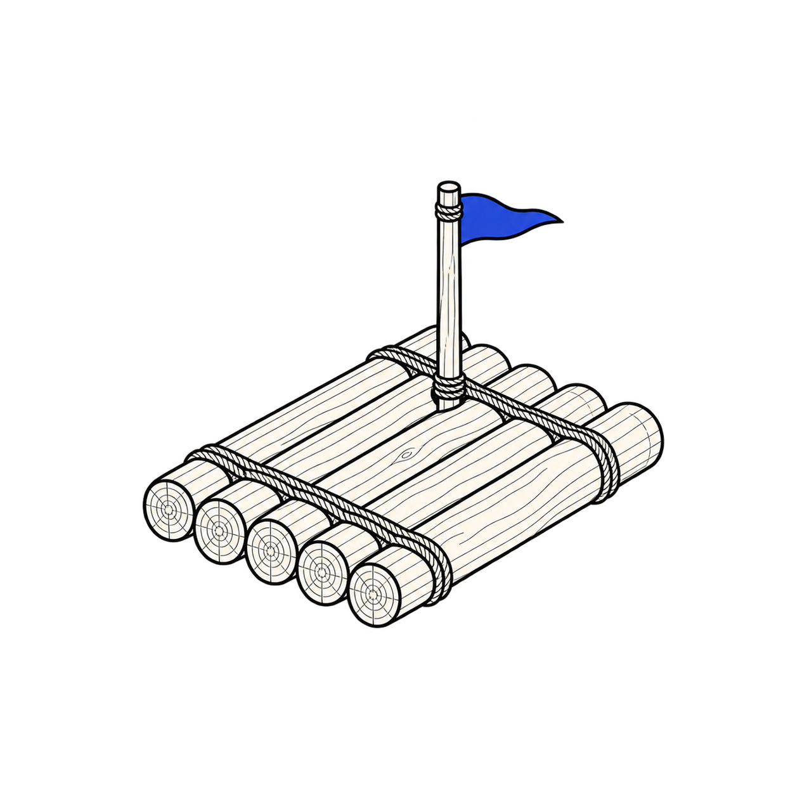

<p align="center">
  
</p>

<h1 align="center">raft</h1>

<p align="center">
  <a href="https://github.com/Microck/raft/actions/workflows/check.yml"></a>
  <a href="LICENSE"></a>
</p>

---

`raft` is an independent, self-hosted open-source alternative to
[boat.dev](https://boat.dev). it gives you persistent Linux boxes on machines you
control, with command execution, Docker, file transfer, snapshots, forks and a
private desktop. Raft is not affiliated with Boat.

[setup](docs/operations.mdx) | [feature parity](docs/boat-capabilities.md) | [verification](docs/verification.mdx) | [agent skill](skills/raft-cli/SKILL.md) | [docs site](https://raft.micr.dev/)

## quickstart

follow the [setup guide](docs/operations.mdx) to install the CLI, configure SSH,
set up Incus and download or build an image.

install the CLI on Linux with Python 3.11.8+:

```sh
npm install -g @microck/raft
raft --version
```

`raft self-update` upgrades the CLI later. Raft prints a one-line stderr notice
when a new release exists; set `RAFT_NO_UPDATE_CHECK=1` to turn it off.

Python wheels and source archives are also available in
[releases](https://github.com/Microck/raft/releases). npm installation does not set
up hosts or download workspace images.

| requirement | minimum |
| --- | --- |
| host | dedicated ARM64 or AMD64 Ubuntu host, 2 CPUs, 8 GiB RAM, 80 GiB free disk, plus the pool size if you enable own box disks |
| host access | SSH and passwordless sudo |
| controller | Linux, Python 3.11.8+, SSH and SCP; npm or uv for installation |

then onboard a dedicated Ubuntu host over key-based SSH. `raft host add` checks
the host, shows its plan, provisions Incus, imports a verified image and runs a
smoke test:

```sh
raft host add lab --ssh ubuntu@192.0.2.10
```

once your host and image are configured, run the commands below. replace `lab`
with a location from your configuration:

```sh
box=$(raft new --location lab --ttl 600)
raft exec "$box" -- node --version
raft ssh "$box"
raft stop "$box"
```

`raft stop` and expiration keep persistent boxes on disk. `new --disposable`
deletes a temporary box when it stops or expires. `raft resume` starts
the box with a new lifetime. `raft destroy` deletes the box and its snapshots.
`raft policy lab --delete-stopped-after 48` makes the host delete boxes left
stopped for 48 hours, and logs each deletion in its journal. disposable
creation, prune and retention require the current host worker; redeploy from
the current checkout before using them.

size boxes for the job: `--cpu`, `--memory` and `--disk` take any whole number
up to the host. on hosts deployed with `--disk-pool SIZE`, `--disk 20GiB` gives a
box its own disk that it, and Docker inside it, cannot grow past; forks and
templates of it are copy-on-write. raft does not cap how many boxes you keep.
`raft capacity` prints an advisory estimate of what fits; it never blocks a box.
see [box sizing and capacity](docs/reference/capacity.mdx).

`raft config set` stores your defaults for `new`, such as location, TTL, size
and `disposable true`; `new --persistent` keeps one box anyway. size defaults
apply only to boxes from the image: `new --from` and `fork` keep the source's
size. `raft policy lab --require purpose,owner` makes the host reject boxes whose
note lacks those fields, with an error that names the missing flags. policies
are guardrails for agents: anyone with sudo on the host can change them.
see [defaults and host policies](docs/guides/config-policy.mdx).

## image and workspace control

the image builder starts with Debian 13 and installs language runtimes,
build tools, Docker, Chromium, FFmpeg and a noVNC desktop. build your own image
or download an image for your host architecture from
[versioned releases](https://github.com/Microck/raft/releases). pin its fingerprint
in your configuration. see
[image builds and boot measurements](docs/boot-performance.mdx) for checks and timings.

see the task guides for [background jobs](docs/guides/background-jobs.mdx),
[file transfer](docs/guides/files.mdx),
[snapshots and forks](docs/guides/snapshots-forks.mdx),
[private services and desktops](docs/guides/desktop-services.mdx),
[backup and recovery](docs/guides/backup-recovery.mdx)
and [Docker](docs/guides/docker.mdx).

See [project setup and templates](docs/guides/project-setup.mdx),
[persistent services](docs/guides/long-running-services.mdx),
[scripting and CI](docs/guides/scripting-ci.mdx),
[disposable CI jobs](docs/guides/ci-jobs.mdx), and
[upgrades](docs/guides/upgrades.mdx) for complete operator workflows.

stop the source box before taking a snapshot, restoring one or making a fork.
stopping a box ends its jobs without saving process memory.

backups include the box's files and credentials. keep them private and import
only trusted exports. a long backup can delay expiration checks on its host.

## startup performance

median startup times from five runs per architecture on native Ubuntu 24 CI
hosts. each box had one CPU, 2 GiB RAM and a cached image:

| measurement | ARM64 | AMD64 |
| --- | ---: | ---: |
| command ready after create | 0.87 s | 1.38 s |
| Docker ready after create | 2.28 s | 3.04 s |
| desktop, after its separate start request | 1.12 s | 1.59 s |
| compressed development image | 1.79 GiB | 1.86 GiB |

times depend on hardware, installed software and services, storage, image cache
and SSH latency. the measurements include CLI and SSH overhead. they exclude
image downloads and host reboots.

the first image unpack can take longer. the runners used different hardware,
so these results do not show that ARM64 is faster.

both native images passed the lifecycle tests and all 31 development-tool checks. see
[measurements and methodology](docs/boot-performance.mdx) for raw samples,
resume timings and the measured image-size and desktop-startup improvements.

## feature parity

✅ supported · ❌ unavailable · ❓ not established in Boat's docs. matching checks
do not imply identical behavior. the [full comparison](docs/boat-capabilities.md)
records differences, sources and test coverage.

| Capability | Boat | Raft | Raft limits / differences |
| --- | :---: | :---: | --- |
| Self-hosting on operator hardware | ❌ | ✅ | Incus on your hosts |
| Native ARM64 workspaces | ❌ | ✅ | Boat documents x86_64 machines only |
| Create/list/inspect/delete | ✅ | ✅ | Single operator |
| Persistent stop/resume | ✅ | ✅ | Shared host kernel |
| TTL and lifetime extension | ✅ | ✅ | Persistent boxes retain disk; disposable boxes delete |
| CPU/memory sizing and usage | ✅ | ✅ | Any whole CPU count and GiB size up to the host. Usage covers the shared pool or the box's own disk |
| Host capacity estimates | ❌ | ✅ | Advisory only; Raft has no box count limit. Boat reports plan limits |
| Root terminal and command execution | ✅ | ✅ | Host SSH transport |
| Disposable foreground CI jobs | ✅ | ✅ | `raft run`: fixed timeout, Git-aware upload, artifact collection, guarded cleanup; host SSH trust, not scoped API keys |
| Background jobs, logs and cancellation | ✅ | ✅ | No process checkpoints |
| File upload/download | ✅ | ✅ | Files and recursive trees; new directory destinations only |
| Snapshots and same-host forks | ✅ | ✅ | Stopped source, checked under the lifecycle lock |
| Deploy/delete named snapshots | ✅ | ✅ | Same-host templates and named snapshot deletion |
| Portable backup/recovery | ❓ | ✅ | Raft native archives; Boat whole-instance archive import is not established |
| Docker and development tools | ✅ | ✅ | Native ARM64 and AMD64 images. See [image tests](docs/boot-performance.mdx) |
| Private port forwarding | ✅ | ✅ | Local SSH tunnel |
| Desktop access | ✅ | ✅ | noVNC; see verification limits |
| Reverse forwarding | ✅ | ❌ | Not implemented |
| Public workspace hosting and browser-only streaming | ✅ | ❌ | Not implemented |
| Resize on resume/fork | ✅ | ✅ | Optional CPU/RAM overrides; disks keep their size |
| CLI-wide JSON mode | ✅ | ❌ | Boat JSON/JSONL; Raft list/info/usage/capacity/config plus prune JSONL |
| Snapshot file browsing/download | ✅ | ❌ | Whole-box backup only |
| Strict per-box disk quotas | ✅ | ✅ | On hosts deployed with `--disk-pool`, `new --disk SIZE` gives a box its own fixed-size, copy-on-write disk; the default shared pool has none |
| Separate-kernel VM isolation | ✅ | ❌ | Container runtime |
| Named environments and managed secrets | ✅ | ❌ | Manual configuration |
| Organizations and webhooks | ✅ | ❌ | Raft is single-operator; no event API |
| Dashboard, remote API and SDK | ✅ | ❌ | CLI only |
| Managed agent conversations | ✅ | ❌ | Not implemented |
| Automatic deletion and retention | ✅ | ✅ | Disposable deletion, optionally by default; per-host retention deletes boxes stopped for N hours; age-based prune with preview |
| CLI self-update | ✅ | ✅ | Explicit `raft self-update` for npm and uv installs plus a daily stderr notice. Boat also updates itself after commands; Raft only notifies |

## verification and development

run `uv sync --locked` to install dependencies and `uv run raft --help` to check
the CLI. [verification](docs/verification.mdx) lists the real-host test suites.
they create disposable boxes and remove only their own fixtures.

the optional `--restart-incus` check restarts the host's Incus daemon. run it on
dedicated test infrastructure.

the tests cover Raft's behavior. they do not compare it against the live Boat
service. Raft has not had a security audit.

read [the contract](docs/contract.md), [architecture and references](docs/boat-parity-design.md)
and the optional [agent skill](skills/raft-cli/SKILL.md).

## license

[MIT](LICENSE). third-party tools retain their own licenses.
